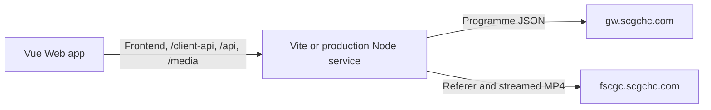

# Architecture

This document describes the current implementation. Development conventions are in [AGENTS.md](../AGENTS.md), commands in [README](../README.md), hosting instructions in [Deployment](deployment.md), and external contracts in [Upstream API](upstream-api.md).

## Runtime

Development and local build preview use Vite with shared proxy middleware. Production runs `server/main.ts` directly in Node and serves `dist/` without loading Vite. Each mode uses one process and port.

The service streams video with backpressure. It does not save videos or maintain download jobs.

## Module Ownership

| Module                                 | Responsibility                                                                     |
| -------------------------------------- | ---------------------------------------------------------------------------------- |
| `src/main.ts`                          | Browser entry: install Pinia and the router, then mount the app                    |
| `src/App.vue`                          | Root Naive UI providers                                                            |
| `src/layouts/`                         | Application navigation shell and cached route presentation                         |
| `src/router/`                          | Route composition, lazy page imports, and scroll behaviour                         |
| `src/theme/`                           | Naive UI theme overrides and synchronization with saved preferences                |
| `src/shared/components/`               | Shared covers and loading, empty, and error feedback                               |
| `src/shared/composables/`              | Validated reactive persistence                                                     |
| `src/shared/utils/`                    | Errors, stale-request guards, and browser view transitions                         |
| `src/shared/media/`                    | Quality schema/types, media-proxy URLs, and browser download handoff               |
| `src/features/programmes/api/`         | Normalized programme DTO validation and Web programme/playback/download adapters   |
| `src/features/programmes/model/`       | Programme types, content presentation, and displayed video variants                |
| `src/features/programmes/stores/`      | Shared programme catalogue cache                                                   |
| `src/features/programmes/composables/` | Archive requests, selection, spotlight, cover navigation, and download preparation |
| `src/features/programmes/components/`  | Programme cards, archive controls, download menus, and player UI                   |
| `src/features/programmes/views/`       | Programme library and broadcast archive pages                                      |
| `src/features/settings/model/`         | Preference validation and inferred settings type                                   |
| `src/features/settings/stores/`        | Persistent settings and favourite programme IDs                                    |
| `src/features/settings/views/`         | Settings page                                                                      |
| `src/styles/global.css`                | Base CSS, theme variables, shared styles, and motion                               |
| `server/main.ts`                       | Production configuration, HTTP startup, and graceful shutdown                      |
| `server/http-app.ts`                   | Production static assets, readiness, caching, and HTTP method handling             |
| `server/proxy/proxy-middleware.ts`     | Route dispatch, method handling, and invalid-target responses                      |
| `server/proxy/proxy-policy.ts`         | API allowlist/pagination, media target validation, and attachment filenames        |
| `server/proxy/programme-headers.ts`    | Android guest request profile and browser-scoped upstream device identity          |
| `server/proxy/stream-upstream.ts`      | Upstream fetch, headers, timeout, disconnect cancellation, and streaming           |
| `tooling/upstream-proxy-plugin.ts`     | Vite development and preview adapter for the same proxy middleware                 |

`shared/contracts/` owns platform-neutral application DTO schemas/types and `shared/fixtures/` owns cross-language contract examples. `src/shared/platform/` owns injectable ports; `src/platform/` composes their concrete adapters. `server/programmes/` owns upstream validation, normalization, quality resolution, and filenames. `server/client-api/` owns normalized routes and reference-based preparation. These sources are shared by production and Vite middleware without importing browser modules into Node.

Views compose components and coordinate user feedback. Composables own local lifecycles; Pinia stores own shared state. Domain functions are independent of UI feedback. Shared utilities do not import feature stores, and browser code does not import server modules.

Features group business workflows; responsibility directories explain where a file belongs within each feature. Programme browsing, archive selection, preview, and download preparation form one workflow, so they live in `features/programmes/`. Preferences form `features/settings/`. Each feature uses `views/`, `components/`, `composables/`, `stores/`, `api/`, and `model/` as needed. Omit unused directories. Keep the programme components together; their current size does not require additional library, archive, or player subdivisions.

Place routed pages in their feature's `views/` and business components in its `components/`, including features with a single page or component. Application composition lives at the outer level: `App.vue`, `layouts/`, `router/`, and `theme/`. Shared components and platform helpers stay in `shared/`. A component needs its own folder only when it owns additional implementation files; a colocated test alone does not require another directory.

Dependencies point from application composition to features, and from features to shared code. Programme API/model modules do not depend on settings, stores, composables, or UI. Download preparation uses programme domain rules; the archive view presents its result. Shared quality types let settings validate preview preferences without importing programme API schemas. The browser handoff helper only accepts a URL and filename and has no programme dependency. The production server has no dependency on browser modules or Vite tooling. ESLint enforces these production boundaries, with regression fixtures in `tooling/module-boundaries.test.js`.

Use `@/` for internal browser imports; Vite, Vitest, and the browser TypeScript configuration resolve it to `src/`. Directly executed Node modules use relative imports with explicit `.ts` extensions and `NodeNext` resolution. Both environments enable `verbatimModuleSyntax`; Node additionally requires erasable syntax. Keep runtime and type imports separate. This follows the current [Vue TypeScript guidance](https://vuejs.org/guide/typescript/overview.html) and [Node TypeScript execution rules](https://nodejs.org/api/typescript.html).

Name modules after their responsibility, such as `programme-api.ts`, `content-presentation.ts`, `download-file.ts`, and `settings-schema.ts`. Vue components use PascalCase; views describe the page (`ProgrammeLibraryView`, `ProgrammeArchiveView`), and composable/store filenames match their `useXxx` exports. Tests remain beside their owners. `useProgrammeCoverNavigation.test.ts` is beside the composable even though it mounts the layout and pages to exercise real navigation. Test fixtures may import application composition and consuming modules; browser/server separation still applies to tests.

Browser imports of the root contracts use `@shared/`, configured in Vite, Vitest, and TypeScript. Direct Node imports of those contracts remain relative with `.ts` extensions. Shared contracts cannot import `src/` or `server/`; feature modules cannot import `src/platform/`; Vue components cannot import native Tauri APIs.

The directory choices are informed by these actual Vue applications, adjusted to this app's three pages rather than copied wholesale:

| Reference                                                                                                                  | Observed organization                                              | Choice here                                                                                  |
| -------------------------------------------------------------------------------------------------------------------------- | ------------------------------------------------------------------ | -------------------------------------------------------------------------------------------- |
| [create-vue TypeScript/router template](https://github.com/vuejs/create-vue/tree/main/template/code/typescript-router/src) | Root app, router, components, and views                            | Keep application composition explicit and distinguish pages from components                  |
| [SPlayer source](https://github.com/SPlayer-Dev/SPlayer/tree/dev/src)                                                      | Responsibility directories, with subdirectories for complex groups | Add another grouping level only when the implementation needs it                             |
| [Directus files module](https://github.com/directus/directus/tree/main/app/src/modules/files)                              | Business modules own their components and route pages              | Keep related programme code within one feature and use consistent responsibility directories |

## Programme Browsing

The interface uses real upstream data with distinct loading, empty, error, and retry states. It does not fabricate programme records or download progress.

`useProgrammeCatalogueStore` caches the catalogue; explicit refresh replaces it. `useProgrammeArchive` loads dates for the current programme, then requests contents with the matching date ID. It clears stale content when the programme or date changes and makes no content request without a date.

`AbortController` cancels obsolete work. `LatestRequest` separately prevents obsolete results from committing state, even if cancellation arrives too late. Requests are cancelled when their scope ends.

The Node programme client validates and normalizes upstream records. The browser validates the resulting application DTOs before they enter feature state. The catalogue/archive consume the injected programme port, keeping transport selection outside their stores and views. See [Upstream API](upstream-api.md) for schemas, IDs, and field mapping.

The all-programmes tab snapshots favourite priority when the library view is created. Those favourites come first under every sort mode for the browsing session, including search results; default order preserves service order within each group, while name order sorts each group separately. Toggling favourites updates stars and counts immediately without moving cards. Returning from details, changing filters or sort mode, and refreshing programme data retain the same priority snapshot; a full browser refresh applies the latest favourites. The favourites tab filters current favourites immediately and orders them by the selected service or name order.

The spotlight selects a catalogue entry when the view is created and changes only on manual shuffle or removal of that entry. Filtering and metadata refresh preserve the chosen ID. There is no automatic rotation.

The route shell keeps one library instance alive for the current app session. Returning from programme details or settings preserves the search, favourites filter, sort order, spotlight, and cover DOM. The library records its scroll position before leaving and restores it after reactivation; the router does not reset this route to the top. A full browser refresh starts a new browsing session. Programme details and settings are not cached, preserving archive cancellation and player cleanup when details unmount.

## Selection and Downloads

`useContentSelection` owns selectable IDs independently of quality. Rows with either video variant are selectable. Full-episode matching uses the programme name and broadcast date in the title, including supported parentheses variants; list position is not evidence of a full episode.

Content presentation separates the date picker, full episodes, and clips into sibling panels. Full episodes retain service order in individual cards with large covers and vertically centred details, followed by a labelled clip panel sorted by publication time. Clips remain in a single column and align their covers and titles at the top, with publication times directly below their titles and a separate download action aligned with the bottom of the cover on desktop. Both sections vertically centre selection checkboxes in a trailing column outside the covers. The selection count, bulk selection controls, and batch download form one toolbar group on the right above the cards; narrower screens wrap selection controls below the date and batch action. Covers open playback previews. Full-episode covers sit above their details on narrow screens, while clips retain compact thumbnails. The default clip order is ascending; an icon button in the clip panel heading toggles ascending and descending order, with the current order in its tooltip and accessible label. The sort control is absent when there are no clips. Changing the presentation order preserves selected IDs and does not mutate archive data. Missing or invalid publication times follow dated clips in either direction, retaining service order for ties. Clips display publication dates and times in `Asia/Shanghai`; offset-free upstream timestamps use that same timezone, and unavailable times are shown as unknown. Full-episode cards omit publication times.

Individual rows and the batch action share `ProgrammeDownloadButton`. Clicking opens a quality menu. Selecting a quality immediately prepares files and starts browser handoff; dismissing the menu does nothing. A mixed batch can fall back to an available variant, and filenames reflect the actual quality.

`server/programmes/download-file.ts` resolves the actual quality and sanitizes filenames. The browser submits programme/date/content IDs to `/client-api/v1/downloads/prepare`; the backend fetches matching records and derives the broadcast date. The Web download adapter processes prepared files independently. `handOffDownload` performs a HEAD request through the media proxy and validates video content type and attachment headers before clicking a temporary download link.

`useProgrammeDownloads` tracks only IDs undergoing preparation. This prevents duplicate clicks during preflight, while allowing later retries. Files are processed independently; a failed preflight does not stop the rest of a batch. The composable returns the selected platform's typed start result; the archive view presents browser handoffs, fallbacks, and per-file failures without navigation. Native result types exist for later integration, but current startup composes only Web adapters.

A handoff means the browser was asked to save a file. The browser owns transfer progress, destination, pause, cancellation, resume, and completion. There is no persistent queue or download history, and the legacy `sctv-dl:downloads` key is not read. Video is never fully buffered into a page Blob.

## Settings

VueUse persistence uses the existing `sctv-dl:settings` key and synchronizes browser tabs. Zod supplies defaults for invalid fields; damaged JSON falls back to defaults. Unavailable storage is surfaced without preventing use of the app.

Theme defaults to following the system, while valid saved choices are retained. Saved quality controls the initial preview variant; each download chooses its own quality.

## UI and Player Lifecycle

Naive UI provides controls, tabs, menus, modal focus management, and library transitions. Vue scoped CSS supplies application styles, and the global stylesheet owns theme variables. The root reserves scrollbar space so filtering and modal scroll locking do not change page width; root margins suppress duplicate library compensation where stable gutters are supported.

See [Web Styling](styling.md) for native CSS conventions and styling ownership.

Custom motion is brief and respects reduced-motion preferences. Newly visible programme cards fade in, while sorting reorders the grid without positional animation.

Artplayer owns playback controls, speed, shortcuts, picture-in-picture, fullscreen, and the bottom-toolbar quality menu. Available variants omit duplicate URLs. Quality switching keeps the same player instance and playback position. Preview starts without autoplay.

Closing a preview pauses immediately but keeps its title and player mounted through the modal's leave animation. The displayed snapshot clears after leaving; unmounting destroys the player. A delayed close callback must not clear a newly reopened preview. Initialization/media errors reach the dialog, and successful metadata loading clears its error state.

## Library Choices

| Capability                                                | Implementation                               |
| --------------------------------------------------------- | -------------------------------------------- |
| UI, menus, selection controls, and modals                 | Naive UI                                     |
| Reactive persistence and system theme                     | VueUse with the settings schema adapter      |
| Boundary validation and inferred domain types             | Zod                                          |
| Video controls and source switching                       | Artplayer                                    |
| Static content types, ETags, lookup, and SPA fallback     | sirv                                         |
| Three GET APIs, URL parsing, deduplication, and streaming | Native fetch, URL, Map/Set, and Node streams |

Business-specific quality fallback, full-episode matching, filenames, and request guards remain small named functions. Introduce additional infrastructure when a concrete requirement needs it, rather than replacing working platform capabilities merely to reduce line count.

See [Deployment](deployment.md) for static-file routing and caching, and [Upstream API](upstream-api.md) for proxy restrictions and streaming headers.
