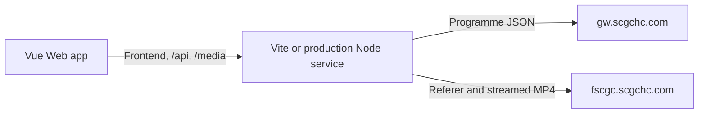

# Architecture

This document describes the current implementation. Development conventions are in [AGENTS.md](../AGENTS.md), commands in [README](../README.md), hosting instructions in [Deployment](deployment.md), and external contracts in [Upstream API](upstream-api.md).

## Runtime

Development and local build preview use Vite with shared proxy middleware. Production runs `server/index.ts` directly in Node and serves `dist/` without loading Vite. Each mode uses one process and port.

The service streams video with backpressure. It does not save videos or maintain download jobs.

## Module Ownership

| Module                               | Responsibility                                                                   |
| ------------------------------------ | -------------------------------------------------------------------------------- |
| `src/app/`                           | Routing, component-library theme, and system theme synchronization               |
| `src/layouts/`                       | Navigation and application shell                                                 |
| `src/components/`                    | Shared covers and loading, empty, and error feedback                             |
| `src/features/programmes/`           | API schemas, catalogue cache, archive requests, selection, library, and previews |
| `src/features/downloads/`            | Quality resolution, safe filenames, HEAD preflight, and browser handoff          |
| `src/features/settings/`             | Validated theme, initial preview quality, and favourites                         |
| `src/shared/`                        | Persistence, errors, media URLs, and stale-request guards                        |
| `src/styles/global.css`              | Tailwind entry, theme tokens, shared styles, and motion                          |
| `server/proxy.ts`, `server/media.ts` | Restricted upstream requests and media target/header validation                  |
| `server/vite-plugin.ts`              | Development and preview proxy adapter                                            |
| `server/app.ts`, `server/index.ts`   | Production static files, health route, HTTP startup, and shutdown                |

Views compose components and coordinate user feedback. Composables own local lifecycles; Pinia stores own shared state. Domain functions are independent of UI feedback. Shared utilities do not import feature stores, and browser code does not import server modules.

## Programme Browsing

The interface uses real upstream data with distinct loading, empty, error, and retry states. It does not fabricate programme records or download progress.

The programme store caches the catalogue; explicit refresh replaces it. `useProgrammeArchive` loads dates for the current programme, then requests contents with the matching date ID. It clears stale content when the programme or date changes and makes no content request without a date.

`AbortController` cancels obsolete work. `LatestRequest` separately prevents obsolete results from committing state, even if cancellation arrives too late. Requests are cancelled when their scope ends.

The API client validates and normalizes upstream records before they enter feature state. See [Upstream API](upstream-api.md) for schemas, IDs, and field mapping.

Favourites come first under every sort mode. Default order preserves service order within each group; name order sorts each group separately. Search and the favourites tab use the same ordering.

The spotlight selects a catalogue entry when the view is created and changes only on manual shuffle or removal of that entry. Filtering and metadata refresh preserve the chosen ID. There is no automatic rotation.

## Selection and Downloads

`useContentSelection` owns selectable IDs independently of quality. Rows with either video variant are selectable. Full-episode matching uses the programme name and broadcast date in the title, including supported parentheses variants; list position is not evidence of a full episode.

Individual rows and the batch action share `ProgrammeDownloadButton`. Clicking opens a quality menu. Selecting a quality immediately prepares files and starts browser handoff; dismissing the menu does nothing. A mixed batch can fall back to an available variant, and filenames reflect the actual quality.

`makeDownloadFile` resolves the variant and sanitizes the filename. `handOffDownload` performs a HEAD request through the media proxy and validates video content type and attachment headers before clicking a temporary download link.

The view tracks only IDs undergoing preparation. This prevents duplicate clicks during preflight, while allowing later retries. Files are processed independently; a failed preflight does not stop the rest of a batch. A notification reports handoffs, fallbacks, failures, and the first failed file's error without navigation.

A handoff means the browser was asked to save a file. The browser owns transfer progress, destination, pause, cancellation, resume, and completion. There is no persistent queue or download history, and the legacy `sctv-dl:downloads` key is not read. Video is never fully buffered into a page Blob.

## Settings

VueUse persistence uses the existing `sctv-dl:settings` key and synchronizes browser tabs. Zod supplies defaults for invalid fields; damaged JSON falls back to defaults. Unavailable storage is surfaced without preventing use of the app.

Theme defaults to following the system, while valid saved choices are retained. Saved quality controls the initial preview variant; each download chooses its own quality.

## UI and Player Lifecycle

Naive UI provides controls, tabs, menus, modal focus management, and library transitions. Tailwind supplies application styles and theme tokens. The root reserves scrollbar space so filtering and modal scroll locking do not change page width; root margins suppress duplicate library compensation where stable gutters are supported.

See [Web Styling](styling.md) for the Tailwind assessment and proposed styling simplification.

Custom motion is brief and respects reduced-motion preferences. Newly visible programme cards fade in, while sorting reorders the grid without positional animation.

Artplayer owns playback controls, speed, shortcuts, picture-in-picture, fullscreen, and the bottom-toolbar quality menu. Available variants omit duplicate URLs. Quality switching keeps the same player instance and playback position. Preview starts without autoplay.

Closing a preview pauses immediately but keeps its title and player mounted through the modal's leave animation. The displayed snapshot clears after leaving; unmounting destroys the player. A delayed close callback must not clear a newly reopened preview. Initialization/media errors reach the dialog, and successful metadata loading clears its error state.

## Library Choices

| Capability                                                | Implementation                               |
| --------------------------------------------------------- | -------------------------------------------- |
| UI, menus, selection controls, and modals                 | Naive UI                                     |
| Reactive persistence and system theme                     | VueUse with the settings schema adapter      |
| Boundary validation and inferred domain types             | Zod                                          |
| Video controls and source switching                       | Artplayer                                    |
| Static content types, ETags, lookup, and SPA fallback     | sirv                                         |
| Three GET APIs, URL parsing, deduplication, and streaming | Native fetch, URL, Map/Set, and Node streams |

Business-specific quality fallback, full-episode matching, filenames, and request guards remain small named functions. Introduce additional infrastructure when a concrete requirement needs it, rather than replacing working platform capabilities merely to reduce line count.

See [Deployment](deployment.md) for static-file routing and caching, and [Upstream API](upstream-api.md) for proxy restrictions and streaming headers.
