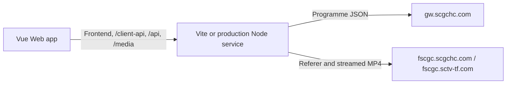

# Web and Shared Frontend Architecture

This document owns the shared Vue frontend and Web/Node implementation. Native internals belong to the [desktop](desktop.md), [Kotlin Android](android.md), and [Flutter](flutter.md) guides. Development conventions are in [AGENTS.md](../AGENTS.md), commands in [README](../README.md), hosting instructions in [Deployment](deployment.md), and external contracts in [Upstream API](upstream-api.md).

## Runtime

Development and local build preview use Vite with shared proxy middleware. Production runs `server/main.ts` directly in Node and serves `dist/` without loading Vite. Each mode uses one process and port.

The proxy transport owns response-header deadlines, disconnect cancellation, stream backpressure, and listener cleanup. Header construction and selection live in a separate module; headers arriving before the deadline permit the body to continue streaming.

The service streams video with backpressure. It does not save videos or maintain download jobs. The Tauri client under `src-tauri/` bundles the same frontend and selects native adapters at startup. Rust owns its metadata, opaque playback sessions and streaming media listener, file downloads, and persistence. Desktop routing uses hash history; Web retains ordinary history routes. See [Desktop Development](desktop.md) for the current boundary.

## Module Ownership

| Module                                          | Responsibility                                                                                                  |
| ----------------------------------------------- | --------------------------------------------------------------------------------------------------------------- |
| `src/main.ts`                                   | Platform/store lifetimes, settings hydration, history capture and exit draining, router and scroll composition  |
| `src/App.vue`                                   | Root Naive UI providers                                                                                         |
| `src/layouts/`                                  | Application navigation shell, build version, and cached route presentation                                      |
| `src/router/`                                   | Route composition, lazy page imports, and scroll behaviour                                                      |
| `src/theme/`                                    | Naive UI theme overrides and synchronization with saved preferences                                             |
| `src/shared/components/`                        | Shared covers and loading, empty, and error feedback                                                            |
| `src/shared/composables/`                       | Validated reactive persistence                                                                                  |
| `src/shared/utils/`                             | Errors, stale-request guards, and browser view transitions                                                      |
| `src/shared/navigation/`                        | Tab identity, scoped scroll containers, browser saved positions, and user-intent cancellation                   |
| `src/shared/storage/`                           | Shared browser IndexedDB connection and schema lifecycle                                                        |
| `src/shared/media/`                             | Quality schema/types, media-proxy URLs, and browser download handoff                                            |
| `src/features/programmes/api/`                  | Validated Web and Tauri programme, playback, and download adapters                                              |
| `src/features/programmes/model/`                | Programme types, snapshot and service status, playback snapshots, presentation, and episode matching            |
| `src/features/programmes/stores/`               | Accepted/pending catalogue snapshots and freshness                                                              |
| `src/features/programmes/composables/`          | Cache/live requests, archive restoration, preview/player lifecycles, history sampling, and download preparation |
| `src/features/programmes/components/`           | Programme cards, archive controls, download menus, and player UI                                                |
| `src/features/programmes/views/`                | Programme library and broadcast archive pages                                                                   |
| `src/features/history/api/`                     | Transactional Web and validated native history adapters                                                         |
| `src/features/history/stores/`                  | History observation, maintenance, and active-player capture registrations                                       |
| `src/features/history/components/` and `views/` | Saved-metadata history cards and the shared history page                                                        |
| `src/features/settings/model/`                  | Preference validation and inferred settings type                                                                |
| `src/features/settings/api/`                    | Web persistence and native settings adapters                                                                    |
| `src/features/settings/composables/`            | Download-directory selection and its asynchronous lifecycle                                                     |
| `src/features/settings/stores/`                 | Persistent settings and favourite programme IDs                                                                 |
| `src/features/settings/views/`                  | Settings page                                                                                                   |
| `src/features/downloads/model/`                 | Task reconciliation, removal tombstones, and shared action presentation rules                                   |
| `src/features/downloads/stores/`                | Native task observation, start results, cancellation, and retries                                               |
| `src/features/downloads/views/`                 | Native download task page, progress, and task controls                                                          |
| `src/styles/global.css`                         | Base CSS, theme variables, shared styles, and motion                                                            |
| `server/main.ts`                                | Production configuration, HTTP startup, and graceful shutdown                                                   |
| `server/http-app.ts`                            | Production static assets, readiness, caching, and HTTP method handling                                          |
| `server/http-diagnostics.ts`                    | Server-side failure reporting without caller query values                                                       |
| `server/client-api/client-api-middleware.ts`    | Normalized request lifecycle, dependency assembly, dispatch, and replies                                        |
| `server/client-api/client-route.ts`             | Typed route matching, method/ID checks, and preparation input validation                                        |
| `server/client-api/request-body.ts`             | Bounded JSON request reception and body deadline cleanup                                                        |
| `server/client-api/input-error.ts`              | Transport input errors independent of programme service and response mapping                                    |
| `server/client-api/http-errors.ts`              | Centralized mapping of input and application errors to HTTP responses                                           |
| `server/client-api/programme-service.ts`        | Reference-based playback and download preparation                                                               |
| `server/proxy/proxy-middleware.ts`              | Route dispatch, method handling, and invalid-target responses                                                   |
| `server/proxy/proxy-policy.ts`                  | API allowlist/pagination, media target validation, and attachment filenames                                     |
| `server/proxy/programme-headers.ts`             | Android guest request profile and browser-scoped upstream device identity                                       |
| `server/proxy/proxy-headers.ts`                 | Guest/media request headers, downstream header selection, and attachment metadata                               |
| `server/proxy/stream-upstream.ts`               | Upstream fetch, headers, timeout, disconnect cancellation, and streaming                                        |
| `tooling/desktop-release.ts`                    | Dependency-free release source/version checks and macOS signing configuration                                   |
| `tooling/windows-signing.ps1`                   | Windows signing certificate preparation, failure rollback, and post-build cleanup                               |
| `tooling/upstream-proxy-plugin.ts`              | Vite development and preview adapter for the same proxy middleware                                              |

`shared/contracts/` owns platform-neutral application DTO schemas/types and `shared/fixtures/` owns cross-language contract examples. `src/shared/platform/` owns injectable ports and validated IPC helpers; `src/platform/` composes their concrete adapters. `server/programmes/` owns upstream validation, normalization, quality resolution, and filenames. `server/client-api/` owns normalized routes and reference-based preparation. These sources are shared by production and Vite middleware without importing browser modules into Node.

Startup and unmount share one idempotent disposal path for exit listeners, scroll restoration, Pinia scopes, and platform resources. Cleanup failures retain the original startup failure and are reported at the application boundary.

Views compose components and coordinate user feedback. Composables own local lifecycles; Pinia stores own shared state. Domain functions are independent of UI feedback. Shared utilities do not import feature stores, and browser code does not import server modules.

Features group business workflows; responsibility directories explain where a file belongs within each feature. Programme browsing, archive selection, preview, and download preparation form one workflow, so they live in `features/programmes/`. Preferences and directory selection form `features/settings/`; native task observation and controls form `features/downloads/`. Each feature uses `views/`, `components/`, `composables/`, `stores/`, `api/`, and `model/` as needed. Omit unused directories. Keep the programme components together; their current size does not require additional library, archive, or player subdivisions.

Place routed pages in their feature's `views/` and business components in its `components/`, including features with a single page or component. Application composition lives at the outer level: `App.vue`, `layouts/`, `router/`, and `theme/`. Shared components and platform helpers stay in `shared/`. A component needs its own folder only when it owns additional implementation files; a colocated test alone does not require another directory.

Dependencies point from application composition to features, and from features to shared code. Programme API/model modules do not depend on settings, stores, composables, or UI. Download preparation uses programme domain rules; the archive view presents its result. Shared quality types let settings validate preview preferences without importing programme API schemas. The browser handoff helper only accepts a URL and filename and has no programme dependency. The production server has no dependency on browser modules or Vite tooling. ESLint enforces static and dynamic production import boundaries, with regression fixtures in `tooling/module-boundaries.test.ts`.

Use `@/` for internal browser imports; Vite, Vitest, and the browser TypeScript configuration resolve it to `src/`. Directly executed Node modules use relative imports with explicit `.ts` extensions and `NodeNext` resolution. Both environments enable `verbatimModuleSyntax`; Node additionally requires erasable syntax. Keep runtime and type imports separate. This follows the current [Vue TypeScript guidance](https://vuejs.org/guide/typescript/overview.html) and [Node TypeScript execution rules](https://nodejs.org/api/typescript.html).

Name modules after their responsibility, such as `programme-api.ts`, `content-presentation.ts`, `download-file.ts`, and `settings-schema.ts`. Vue components use PascalCase; views describe the page (`ProgrammeLibraryView`, `ProgrammeArchiveView`), and composable/store filenames match their `useXxx` exports. Tests remain beside their owners. `useProgrammeCoverNavigation.test.ts` is beside the composable even though it mounts the layout and pages to exercise real navigation. Test fixtures may import application composition and consuming modules; browser/server separation still applies to tests.

Browser imports of the root contracts use `@shared/`, configured in Vite, Vitest, and TypeScript. Direct Node imports of those contracts remain relative with `.ts` extensions. Shared contracts cannot import browser/server implementations, Node/native APIs, or browser frameworks; their current runtime dependency is Zod. Feature modules cannot import `src/platform/`; Vue components cannot import native Tauri APIs. Application composition may lazily load its concrete platform and feature modules.

Vite and Vitest inject `package.json.version` as `import.meta.env.APP_VERSION`. The shell reads this build value for its Web/Desktop version label.

The directory choices are informed by these actual Vue applications, adjusted to this app's three pages rather than copied wholesale:

| Reference                                                                                                                  | Observed organization                                              | Choice here                                                                                  |
| -------------------------------------------------------------------------------------------------------------------------- | ------------------------------------------------------------------ | -------------------------------------------------------------------------------------------- |
| [create-vue TypeScript/router template](https://github.com/vuejs/create-vue/tree/main/template/code/typescript-router/src) | Root app, router, components, and views                            | Keep application composition explicit and distinguish pages from components                  |
| [SPlayer source](https://github.com/SPlayer-Dev/SPlayer/tree/dev/src)                                                      | Responsibility directories, with subdirectories for complex groups | Add another grouping level only when the implementation needs it                             |
| [Directus files module](https://github.com/directus/directus/tree/main/app/src/modules/files)                              | Business modules own their components and route pages              | Keep related programme code within one feature and use consistent responsibility directories |

## Programme Browsing

The interface uses real upstream data with distinct loading, empty, error, and retry states. It does not fabricate programme records or download progress.

`useProgrammeCatalogueStore` and `useProgrammeArchive` consume live programme and persistent cache ports. `useProgrammeSnapshot` owns cancellable cache/live reads for one key; `programme-snapshot-state` owns the pure accepted/pending decision. A valid cached snapshot, including an empty array, can render before the network. A first network response renders immediately when no accepted data exists. An identical refresh advances freshness while retaining list identity; changed values remain pending until the user applies them. A late cache read cannot replace a newer live result. Warm refresh errors retain rows and use non-blocking feedback; cold failures retain the error/retry state. Cache hydration alone does not insert a temporary notice above content, avoiding layout shifts during successful background refresh. Pending updates and failures still show their notice, including cache freshness when applicable.

The catalogue derives its public values from accepted snapshots rather than mirroring them through watchers. Its typed service status is shared by the shell and settings: cached data, active refresh, refresh failure, and readiness remain distinct. A saved timestamp does not prove that the latest request succeeded.

Archive updates remain pending while a preview, batch selection, or download preparation holds the current inputs. Applying an update preserves the viewport, with ordinary clamping for shorter content. Surviving selected IDs are reconciled against available rows; explicit date navigation clears selection. Date updates and content identity are coordinated: a removed date falls back to the latest date with an explanation, a changed date ID cancels and clears the previous content, and empty dates cannot retain an obsolete content list. A preview keeps its pinned content reference and display metadata independently of archive refresh.

Metadata snapshots have typed catalogue, programme-date, and programme/date-content keys. Adapters retain at most 200 snapshots and 20 MiB of serialized UTF-8 snapshot data, plus 100 archive browse records. Only parsed effective fields and order determine equality; optional-field normalization and JSON key order do not create updates. Oversized or unavailable storage leaves useful live data in memory with a warning. Web shares the application's IndexedDB connection with history, using separate stores; cache decoding, fallback merging, pruning, and writes remain synchronous steps within the same read/write transaction; native metadata cache remains separate from durable user records.

Archive browse records retain the selected date, clip sort order, and scroll offset. Once date hydration finishes, date and sort changes save immediately. Scroll saves are throttled to one second, with additional capture on scroll end, page hide, visibility loss, and route departure. Initial hydration preserves the saved offset until content layout is ready. New in-app visits to a programme start at the top, while browser back/forward restores the corresponding history-entry offset. An initial document load can fall back to its persisted browse offset. User scrolling or navigation cancels a delayed restoration so it cannot override newer intent.

Owners establish clear notifications before reading. Clearing changes the cache epoch, invalidates pending reads/writes and update notices, and cancels live work without automatically refetching. Already visible rows and their sort order remain available as non-persisted page data. A later explicit refresh or route entry may populate the new epoch. Cache maintenance does not delete settings, favourites, viewing history, or download tasks/files, and does not claim to clear browser HTTP media/image caches.

`AbortController` cancels obsolete work. `LatestRequest` separately prevents obsolete results from committing state, even if cancellation arrives too late. Requests are cancelled when their scope ends.

The Node programme client validates and normalizes upstream records. The browser validates the resulting application DTOs before they enter feature state. The catalogue/archive consume the injected programme port, keeping transport selection outside their stores and views. See [Upstream API](upstream-api.md) for schemas, IDs, and field mapping.

Normalized client requests parse into a discriminated route before creating an upstream identity or contacting a service. HTTP input errors are defined independently of response mapping and programme services; unavailable programme records use a business error. The middleware maps both into the existing status/error contract, owns disconnect cancellation, and removes request listeners on completion. Upstream wrappers retain their causes; HTTP boundaries report server failures while keeping client responses localized.

Browser JSON/DTO validation and native IPC validation preserve underlying error causes while presenting localized messages. Non-cancellable native commands share `invokeValidated`; cancellable requests retain their separate abort protocol and `AbortError` semantics.

The all-programmes tab snapshots favourite priority when the library view is created. Those favourites come first under every sort mode for the browsing session, including search results; default order preserves service order within each group, while name order sorts each group separately. Toggling favourites updates stars and counts immediately without moving cards. Returning from details, changing filters or sort mode, and refreshing programme data retain the same priority snapshot; a full browser refresh applies the latest favourites. The favourites tab filters current favourites immediately and orders them by the selected service or name order.

The spotlight selects a catalogue entry when the view is created and changes only on manual shuffle or removal of that entry. Filtering and metadata refresh preserve the chosen ID. There is no automatic rotation.

Each primary navigation tab retains its last route, live page state, and independent scroll container for the current app session. The shell caches at most four tab workspaces (library, viewing history, settings, and native downloads). Selecting the library tab returns to its current programme detail when one is open; the home brand and explicit return link still navigate to the catalogue. Search, filters, sort, selection, and loaded content survive tab switches. A full browser refresh starts a new tab session.

Within the library tab, one catalogue instance remains cached so returning from details preserves its spotlight, covers, filters, and position. Leaving a detail for the catalogue or another programme still disposes that detail and cancels its requests. Switching primary tabs deactivates the detail instead, allowing pending metadata loads to complete without moving the visible tab. Each workspace provides its own route and scroll target to descendants so hidden pages cannot observe or scroll a different tab. Preview sessions pause, capture progress, and release playback resources on deactivation; returning to a tab does not restart playback.

`useArchiveBrowseRestoration` coordinates hydration, rendered-content readiness, KeepAlive activation, user intent, and deferred scroll restoration. `useArchiveBrowseState` restores a programme's selected date and clip sort before requesting its matching content; it does not first request the latest date. It saves date ID/date, sort, and workspace offset on departure and visibility loss using the loaded cache epoch. The shared scroll coordinator receives browser back/forward positions from the router, which outrank persisted archive offsets. Fresh in-tab entries carry an explicit zero offset so asynchronous hydration cannot jump to an earlier visit; date and sort restoration remain independent. Tab reactivation preserves the live offset instead. Router scroll changes wait until the destination page enters, so an outgoing page never jumps to the top during its leave animation. The archive restores after the matching content renders and clamps to the current workspace scroll range. Navigation and deliberate wheel, touch, or scroll-key input cancel a pending restoration; programmatic scroll events do not. Persisted positions retain lightweight data; live page retention belongs only to the bounded tab workspace cache.

## Viewing History

The history port identifies an entry by programme/date/content IDs, independently of quality or online/local playback. It retains at most 500 entries with pinned programme/date/title/cover metadata, integer millisecond progress, nullable duration, repository-assigned viewing time, and completion. Completion is an ended event or at least 95% of a positive known duration. Completed entries reopen at zero; incomplete entries restore their saved position, always paused. Rewinding and watching can make an entry incomplete again.

History cover buttons and the resume/replay action open the same preview with the saved content IDs; neither depends on a loaded catalogue.

Each explicit preview opens a history session; media retry reuses that session. Per-session sample sequence and latest-session ownership prevent stale writes from replacing a newer preview. Remove and clear invalidate existing session tokens, so an already open player cannot resurrect a deleted entry. Browser transactions enforce this across connections. Storage failures retain usable playback, expose a retryable warning, and do not report durable success.

`usePlaybackHistory` accepts only settled player snapshots. Forward progress writes are throttled to five seconds; seek, pause, ended, close, visibility loss, and explicit exit capture save immediately. Failed preparation and requested-but-unsettled seeks never replace existing progress with zero. Retrying a failed history write preserves its sequence. Capture registrations belong to the preview and remain until committed disposal. The application exit callback captures active players once, then drains history and settings until their issued write revisions stop changing; unsuccessful persistence rejects a successful-save claim. Arbitrary browser/process termination can still lose the most recent unsaved progress.

## Selection and Downloads

`useContentSelection` owns selectable IDs independently of quality. The programme model's `hasPlayableVideo` predicate makes rows with either video variant selectable. The pure `isFullEpisode` rule matches the programme name and broadcast date in the title, including supported parentheses variants; list position is not evidence of a full episode. Quality selection, fallback, and source deduplication belong to the selected backend. The player consumes the validated sources in `PlaybackSession`.

Content presentation separates the date picker, full episodes, and clips into sibling panels. Full episodes retain service order in individual cards with large covers and vertically centred details, followed by a labelled clip panel sorted by publication time. Clips remain in a single column and align their covers and titles at the top, with publication times directly below their titles and a separate download action aligned with the bottom of the cover on desktop. Both sections vertically centre selection checkboxes in a trailing column outside the covers. The selection count, bulk selection controls, and batch download form one toolbar group on the right above the cards; narrower screens wrap selection controls below the date and batch action. Covers open playback previews. Full-episode covers sit above their details on narrow screens, while clips retain compact thumbnails. The default clip order is ascending; an icon button in the clip panel heading toggles ascending and descending order, with the current order in its tooltip and accessible label. The sort control is absent when there are no clips. Changing the presentation order preserves selected IDs and does not mutate archive data. Missing or invalid publication times follow dated clips in either direction, retaining service order for ties. Clips display publication dates and times in `Asia/Shanghai`; offset-free upstream timestamps use that same timezone, and unavailable times are shown as unknown. Full-episode cards omit publication times.

Individual rows and the batch action share `ProgrammeDownloadButton`. Clicking opens a quality menu. Selecting a quality immediately prepares files and starts browser handoff; dismissing the menu does nothing. A mixed batch can fall back to an available variant, and filenames reflect the actual quality.

`server/programmes/download-file.ts` resolves the actual quality and sanitizes filenames. The browser submits programme/date/content IDs to `/client-api/v1/downloads/prepare`; the backend fetches matching records and derives the broadcast date. The Web download adapter processes prepared files independently. `handOffDownload` performs a HEAD request through the media proxy and validates video content type and attachment headers before clicking a temporary download link.

`useProgrammeDownloads` tracks only IDs undergoing preparation. This prevents duplicate clicks during preflight, while allowing later retries. Files are processed independently; a failed preflight does not stop the rest of a batch. The composable returns the selected platform's typed start result; the archive view presents browser handoffs or native queue acceptance, fallbacks, and per-file failures without navigation. Native starts use the task store's `start` action, which retains per-file preparation failures; retries and batch actions revalidate the existing task and attempt. An initial start supplies the native port explicitly, so downloading does not wait for task observation to connect. `AppLayout` owns the native store's subscription across route changes and detaches it when the shell unmounts. The observer subscribes before requesting a snapshot and merges process epochs, monotonic revisions, and removal tombstones. Task actions carry an attempt ID, so delayed confirmations cannot affect a replacement transfer. The desktop-only `/downloads` page reads this shared state; its navigation entry shows an active-task badge and hides zero counts. The native platform composes Rust services and the Channel adapter. See [Desktop Development](desktop.md) for native queue/file ownership and platform acceptance.

`download-task-state` owns pure epoch/revision reconciliation and removal tombstones; the store owns subscriptions and commands. `download-action-presentation` centralizes labels, confirmation policy, and result messages for row and batch actions. The native frontend port exposes snapshot observation and typed actions without unused list/subscribe/cancel aliases. Consumers narrow on the download port's discriminant rather than duplicate capability flags.

The native task list groups transfers behind status filters with counts. Its list header aligns select-all with row checkboxes. Applicable batch actions appear as direct buttons at the right of the fixed-height list header; narrow screens scroll those buttons horizontally. Batch outcomes appear below the list so feedback does not shift task rows. Rows show the saved programme title and cover without a filename line. Only existing completed files expose cover playback; active or incomplete transfers show progress, while completed rows show saved size. One primary action stays visible, with secondary file and record actions in a keyboard-operable menu. Destructive confirmations distinguish file deletion from record removal and revalidate the attempt before dispatch.

A handoff means the browser was asked to save a file. The browser owns transfer progress, destination, pause, cancellation, resume, and completion. Browser handoffs have no persistent transfer queue or download history, and the legacy `sctv-dl:downloads` key is not read. Video is never fully buffered into a page Blob.

## Settings

The shared settings store owns reactive preferences and consumes an injected settings port. Startup hydrates that port before mounting the regular UI. Connection versions invalidate obsolete asynchronous work. Snapshot revisions track both accepted external updates and local edits, while local edit revisions determine whether hydration must save a newer local value. Subscription updates and delayed loads cannot overwrite newer local edits; asynchronous saves are serialized, and failed writes retain usable in-memory values with a platform-neutral warning. `flush` waits until the save queue stops growing. Store disposal removes subscriptions, including ones that finish connecting afterward.

The Web adapter retains VueUse persistence, the existing `sctv-dl:settings` key, and browser-tab synchronization. Zod supplies defaults for invalid fields; damaged JSON falls back to defaults. The native adapter uses validated domain commands backed by Rust and the official Store plugin. Native identity and directory remain outside the shared DTO. See [Desktop Development](desktop.md) for composition and coordinated exit.

Theme defaults to following the system, while valid saved choices are retained. Saved quality controls the initial preview variant; each download chooses its own quality.

`useDownloadDirectory` owns directory state, picker actions, request revisions, and scope cleanup. The settings view consumes those values without managing the asynchronous protocol. Native directory selection remains outside the shared settings DTO, and browser downloads retain browser-managed destination behavior.

## UI and Player Lifecycle

Naive UI provides controls, tabs, menus, modal focus management, and library transitions. Vue scoped CSS supplies application styles, and the global stylesheet owns theme variables. The viewport-sized shell gives the workspace its own scroll container and stable scrollbar gutter. Navigation stays outside this container, while native boundary feedback remains within the content. Shared navigation helpers normalize negative WebKit bounce offsets to zero when capturing positions, without changing the live scroll effect. They read and restore workspace offsets; the router records offsets per history entry because Vue Router otherwise records window offsets.

See [Web Styling](styling.md) for native CSS conventions and styling ownership.

Custom motion is brief and respects reduced-motion preferences. Newly visible programme cards fade in, while sorting reorders the grid without positional animation.

Artplayer owns playback controls, speed, shortcuts, picture-in-picture, fullscreen, and the bottom-toolbar quality menu. Available variants omit duplicate URLs. Quality switching keeps the same player instance and playback position. New online and local previews start paused and preload metadata. Restoration waits for metadata, clamps to actual duration, and remains uninitialized until the native seek settles. A paused preview exposes playback after metadata loads, including WebViews that defer `canplay` until user interaction. Actual playback clears the loading indicator; subsequent buffering and seeking retain Artplayer's loading feedback.

`programme-player-controller` owns Artplayer construction, media events, quality changes, restoration, and destruction. `ProgrammeVideoPlayer` supplies the mounted container and bridges its typed component contract. `useProgrammePreview` owns pinned inputs, cancellable preparation, retry intent, history capture, and session disposal; the dialog owns rendering and the modal after-leave boundary.

`ProgrammeVideoPlayer` exposes capture/pause and emits validated playback snapshots containing position, duration, speed, actual quality, play/pause intent, ended, and initialization state. The dialog retains the last usable snapshot before handling an error. Explicit retry resolves the backend source again by pinned IDs and actual quality, then restores position/speed and resumes only when the prior intent was playing and the same preview remains active and visible. Quality fallback is disclosed. Autoplay rejection leaves a usable paused player. A player-specific Artplayer subclass disables built-in URL reconnect; failed players freeze their last usable capture and cannot clear the error or emit zero progress through later metadata events.

The preview registers a complete quality selector through Artplayer's controls API. It does not partially update the built-in quality option before that option's deferred initialization, which would throw and skip media listener registration. Quality switching also suppresses source-reset samples until the new source settles. Every playback-start event rechecks whether its preview is active and visible; closing or backgrounding a preview revokes an in-flight quality switch's automatic resume.

Closing captures and pauses immediately but keeps the title and player mounted through the modal's leave animation. The displayed snapshot and backend/history sessions are released after leaving; unmounting destroys the player. A delayed close or retry callback cannot clear or autoplay a newer preview. Backgrounding revokes pending retry playback intent. Deactivating a preview in any retained tab captures and releases its resources because no modal leave animation runs off-page.

## Library Choices

| Capability                                                | Implementation                               |
| --------------------------------------------------------- | -------------------------------------------- |
| UI, menus, selection controls, and modals                 | Naive UI                                     |
| Reactive persistence and system theme                     | VueUse with the settings schema adapter      |
| Boundary validation and inferred domain types             | Zod                                          |
| Video controls and source switching                       | Artplayer                                    |
| Static content types, ETags, lookup, and SPA fallback     | sirv                                         |
| Three GET APIs, URL parsing, deduplication, and streaming | Native fetch, URL, Map/Set, and Node streams |

Business-specific quality fallback, full-episode matching, filenames, and request guards remain small named functions. Introduce additional infrastructure when a concrete requirement needs it, rather than replacing working platform capabilities merely to reduce line count.

See [Deployment](deployment.md) for static-file routing and caching, and [Upstream API](upstream-api.md) for proxy restrictions and streaming headers.
