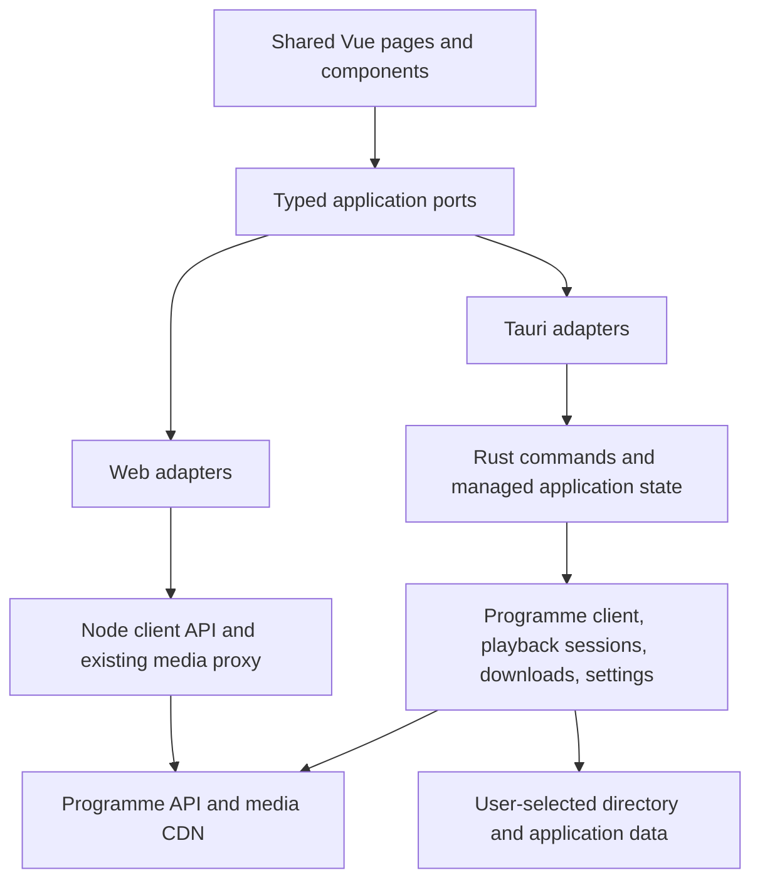

# Shared Web and Tauri Desktop Design

Status: initial implementation authorized and in progress. Shared contracts and Web/Node adaptation are implemented; the macOS native shell builds and launches. Native business services and the two-platform media gate remain pending. See the [implementation plan](../plans/2026-10-16-tauri-desktop.md) for phase status and validation limits.

## Intent and Acceptance Boundary

Add Windows and macOS applications using Tauri 2 while retaining the existing Web application. Maintain one Vue source tree for pages, components, navigation, presentation rules, and view state. The desktop application must work without a separately deployed project server or a bundled Node runtime; internet access remains necessary for upstream content.

The frontend owns rendering, user interaction, selection, filtering, sorting for display, and transient view state. Node owns Web upstream integration; Rust owns desktop upstream integration, native persistence, media access, and file transfers. The frontend validates application DTOs but does not implement the upstream guest profile, parse upstream envelopes, control file writes, or transport video bytes through JavaScript.

First-release scope and acceptance assumptions:

- Proposed first-release matrix: Windows 10/11 x64; macOS 13 or newer on Apple Silicon and Intel. This is a product target, not a statement of Tauri's minimum requirements. Test the lowest supported OS versions before claiming support.
- Preserve all current browsing, archive, favourites, themes, quality selection, batch selection, and preview behaviour.
- Add native downloads with a selected directory, genuine progress, cancellation, and manual retry. Keep tasks alive when navigating between pages.
- Keep download tasks in memory for the current application session. Closing the application cancels unfinished work after explicit confirmation; a cancelled or interrupted transfer can be restarted from zero.
- Pause/resume, restart recovery, automatic updates, tray residency, account synchronization, Linux packages, and store submission are follow-up work. They are not required for the current Web feature set or the initial desktop application.

## Existing Constraints

- Node.js remains `>=24.15.0`; pnpm remains `12.9.1` unless an independently justified dependency change is requested.
- Use Tauri 2 and existing Vue, Pinia, Naive UI, VueUse, Zod, and Artplayer. Prefer official Tauri Dialog and Store plugins, accessed from Rust for desktop operations.
- Use Rust `reqwest` and Tokio for native HTTP, cancellation, and asynchronous file writes. Do not add a generic plugin system, custom IPC framework, monorepo package manager, or a Node sidecar.
- All domain IDs are decimal strings. Reject upstream numeric IDs above `9007199254740991`; retain larger IDs only when supplied as strings.
- `video` means standard quality; upstream `videoStandard` means smooth quality. Preserve fallback behaviour and omit duplicate playback URLs.
- Metadata headers follow the current anonymous Android guest profile, including one persistent desktop installation UUID. Never send those headers to covers or media.
- Media targets remain HTTPS MP4 files on `fscgc.scgchc.com`, without credentials or nondefault ports. Add `Referer: https://scgc.video.play/`; reject redirects.
- Preserve request cancellation, stale-response guards, browser storage compatibility, truthful browser handoff, and player cleanup after the modal leave animation.
- Documentation, comments, tests, and commit messages use English. Product copy and upstream names remain Chinese.
- Do not modify Android behaviour. Commit, push, publish, or deploy only when requested.

## Architecture and Ownership



Put environment detection and dependency selection in `src/platform/`, with `isTauri()` called at startup. Load Tauri adapters dynamically. Vue components consume ports and capability flags; they do not import Tauri APIs. Plain browser startup must never invoke a native API. Desktop development must use native business adapters even though Vite serves the frontend during development.

Use `src-tauri/` for the application, standard `tauri.conf.json`, capabilities, Cargo manifest and lockfile, and native sources. Bundle Vite's static output through `frontendDist`; only development uses `devUrl`. Keep the existing Web commands, production Node service, and `/api` and `/media` contracts working.

Add platform-neutral Zod schemas and inferred DTO types under `shared/contracts/`. Browser imports use an explicit `@shared/` alias; directly executed Node code uses relative `.ts` imports. This is a source directory, not a new workspace package. It must depend on neither `src/` nor `server/`. Cross-language fixtures under `shared/fixtures/` verify equivalent Node and Rust normalization.

To make the frontend boundary apply to both targets, move upstream envelope parsing, normalization, download naming, and backend quality selection out of Vue modules. Add a normalized Node client API under `/client-api/v1`; retain `/api` as the existing raw allowlisted proxy. Wire the normalized API into production, Vite development, and Vite preview. Preserve the existing media route. Update server method handling so the new bounded preparation POST routes are reached before the static GET/HEAD restriction.

Use `VITE_CLIENT_API_BASE` for the normalized client API and preserve `VITE_MEDIA_BASE`. Deprecate `VITE_API_BASE` as a frontend setting: a nondefault legacy value without an explicit new client base must produce an actionable build diagnostic rather than being ignored or treated as normalized data. Update `.env.example` and deployment guidance with this migration. Existing raw `/api` proxy clients retain their route contract.

## Public Contracts

`shared/contracts/programmes.ts` defines normalized `Programme`, `ProgrammeDate`, `ProgrammeContent`, `ContentRef`, and `Quality`. Preserve today's normalized field names: `id`, `name`, `cover`, `date`, `title`, `video`, `smoothVideo`, and `publishedAt`. `ContentRef` contains `programmeId`, `dateId`, and `contentId`.

`shared/contracts/settings.ts` defines `Settings = { quality, theme, favourites }`, preserving current defaults and the browser key `sctv-dl:settings`. `shared/contracts/media.ts` and `downloads.ts` define these transport objects:

```ts
type PlaybackRequest = ContentRef & { quality: Quality }
type PlaybackSession = {
  id: string
  selectedQuality: Quality
  sources: Array<{ quality: Quality; url: string }>
}
type DownloadRequest = {
  programmeId: string
  dateId: string
  contentIds: string[]
  quality: Quality
}
type FileFailure = { contentId: string; message: string }
type DownloadStartResult =
  | { kind: 'cancelled' }
  | { kind: 'browser'; handedOff: number; usedFallback: boolean; failures: FileFailure[] }
  | { kind: 'native'; taskIds: string[]; usedFallback: boolean; failures: FileFailure[] }
type DownloadTask = {
  id: string
  content: ContentRef
  filename: string
  quality: Quality
  state: 'queued' | 'running' | 'completed' | 'failed' | 'cancelled'
  receivedBytes: number
  totalBytes: number | null
  error: string | null
  revision: number
}
```

The application ports are:

- `ProgrammeApi.programmes(signal?: AbortSignal): Promise<Programme[]>`.
- `ProgrammeApi.dates(programmeId: string, signal?: AbortSignal): Promise<ProgrammeDate[]>`.
- `ProgrammeApi.contents(programmeId: string, dateId: string, signal?: AbortSignal): Promise<ProgrammeContent[]>`.
- `PlaybackPort.open(request: PlaybackRequest, signal?: AbortSignal): Promise<PlaybackSession>` and `close(id: string): Promise<void>`.
- `DownloadPort.start(request: DownloadRequest): Promise<DownloadStartResult>`.
- Native-only `NativeDownloadPort.list(): Promise<DownloadTask[]>`, `subscribe(listener: (task: DownloadTask) => void): Promise<() => void>`, `cancel(id: string): Promise<void>`, `getDirectory(): Promise<string | null>`, and `chooseDirectory(): Promise<string | null>`.
- `SettingsPort.load(): Promise<{ value: Settings; persisted: boolean }>`, `save(value: Settings): Promise<void>`, and `subscribe(listener: (value: Settings) => void): Promise<() => void>`.
- `AppPlatform` contains `kind: 'web' | 'tauri'`, the four ports, and capability flags `nativeDownloads` and `directorySelection`.

Validate every Web or IPC result at the adapter boundary. Rust independently validates command input and upstream data; a frontend schema is not authorization. Use `{ code, message }` errors with codes `invalid-input`, `not-found`, `upstream`, `timeout`, `cancelled`, and `storage`. Localize displayed errors at the presentation boundary.

The normalized Web routes are:

| Method | Route                                                             | Result                                                                          |
| ------ | ----------------------------------------------------------------- | ------------------------------------------------------------------------------- |
| GET    | `/client-api/v1/programmes`                                       | `Programme[]`                                                                   |
| GET    | `/client-api/v1/programmes/{programmeId}/dates`                   | `ProgrammeDate[]`                                                               |
| GET    | `/client-api/v1/programmes/{programmeId}/dates/{dateId}/contents` | `ProgrammeContent[]`                                                            |
| POST   | `/client-api/v1/playback/prepare`                                 | `PlaybackSession` with validated upstream source URLs                           |
| POST   | `/client-api/v1/downloads/prepare`                                | `{ files: PreparedDownload[], failures: FileFailure[], usedFallback: boolean }` |

`PreparedDownload = { contentId, title, url, filename, quality }`. Successful routes return `{ data: T }`. Errors return `{ error: { code, message } }` with HTTP 400 for invalid input, 404 for missing content, 502 for upstream failure, 504 for timeout, and 500 for unexpected server errors. Preparation POST bodies are JSON with a 16 KiB limit and at most 100 distinct content IDs. Preparation resolves IDs against backend-fetched upstream records; callers cannot supply arbitrary URLs or destination paths. Web adapters convert validated media URLs into existing `/media` URLs.

## Request Lifecycles

Preserve the existing `AbortSignal` interface and `LatestRequest` guards. Each native metadata or playback-open call carries a UUID request ID; adapters register an abort listener and call `cancel_request(requestId)`. A signal that is already aborted must issue no operation. Clean up listeners and native registry entries on every terminal path. Cancellation that arrives before native registration must still win; use bounded, expiring cancellation markers rather than an unbounded tombstone map.

Keep metadata's 20-second response-header deadline, and use a 30-second idle-read deadline for native bodies and transfers. A long, actively progressing MP4 must not hit a whole-file timeout. Web request disconnection aborts its upstream work. Delayed responses cannot overwrite a newer programme/date, player session, or settings edit.

## Playback Transport and Validation Gate

Artplayer remains the UI player. Metadata and control messages use commands; MP4 bytes never use `invoke`, Channels, base64, or a whole-file page Blob.

First validate Tauri's asynchronous custom protocol, following the official Range example, against remote MP4s on both target WebViews. Map opaque session IDs to Rust-validated sources. Bound each buffered protocol response to 1 MiB; handle HEAD, suffix/open-ended ranges, 206, 416, and early disconnect. Test initial requests without Range and large-file playback without whole-file buffering.

The decision rule is explicit: retain the custom protocol only if both platforms pass initial playback, forward/backward seek, quality switching, lifecycle cleanup, and bounded-memory checks. If either fails because the custom protocol cannot stream the required response shape, use a media-only Rust HTTP endpoint with Tokio and Axum. Bind only `127.0.0.1` on port `0`, authorize opaque per-session URLs, validate origins where present, reject unsupported hosts and redirects, and stream with backpressure. Keep frontend assets on Tauri's default bundled-asset protocol; do not introduce the Localhost asset plugin. Record the selected transport and evidence before completing playback integration. No player control or metadata service uses the media endpoint.

Opening a preview resolves its content reference and available variants in the backend. Switching source within an open session retains player position. Closing pauses immediately, keeps the player through the leave animation, and then releases the session. Reopening during that animation cannot be cleared by an old callback. If an aborted open resolves late, close the returned session immediately.

Fullscreen and PiP are exposed only when supported by the current WebView. Missing browser APIs must degrade cleanly. Covers may remain ordinary HTTPS image requests governed by CSP; they do not receive upstream guest headers.

## Download Behaviour

Web preparation returns the filename and selected actual quality. Retain HEAD preflight and temporary-anchor handoff; only successful handoffs increment `handedOff`. Never display native progress or completion for browser-owned downloads.

For desktop batches, use one native directory selection when no valid directory is saved. Cancelling the picker creates no tasks. Store the selected directory privately in native application data. Validate it again when starting work; inaccessible or removed directories produce actionable errors without silently choosing another location.

Rust resolves the programme/date/content IDs, derives the broadcast date, applies quality fallback and the existing date/title/quality naming pattern, and owns the queue. Run at most two transfers concurrently. Repeated submission of an active content-and-quality combination in the same directory returns the active task ID. Failures are isolated per file. Emit progress at most every 100 ms per task, with every terminal update delivered immediately. Unknown totals remain `null`; never manufacture a percentage.

Reserve a unique destination name without overwriting an existing file; use ` (1)`, ` (2)`, and subsequent suffixes when needed. Handle Windows reserved names, trailing dots/spaces, invalid characters, Unicode titles, long paths, and case-insensitive collisions. Stream into a task-specific temporary file in the destination directory. Report completion only after successful flush/close and finalization without clobbering another file. Remove temporary files and reservations on cancellation/failure; surface cleanup errors. After an unclean process exit, clean only recognized application-owned temporary artifacts, never unrelated files.

Keep task state in Rust managed application state. Native event subscription must precede the initial task-list snapshot; each update carries a monotonic per-task revision so an older snapshot cannot overwrite a newer event. A shared Pinia download store presents tasks across navigation. A small desktop-only task panel exposes status, progress, cancel, and retry. Retrying reconstructs the request from the task content reference and actual quality.

Closing the native window while work is queued/running presents confirmation. Rejecting keeps the window and tasks alive. Accepting cancels tasks, releases streams/files, and exits. Do not add hidden tray/background behaviour.

## Settings and Startup

Web retains VueUse behaviour, cross-tab updates, `sctv-dl:settings`, current schema defaults, and usable in-memory fallback when storage is unavailable. Ignore the obsolete `sctv-dl:downloads` key.

Desktop loads settings through Rust and the official Store plugin before mounting the regular application. Keep desktop-specific values such as directory and installation UUID outside the shared settings DTO. Browser and desktop have independent stores; installing the desktop application does not import browser preferences automatically.

Hydration cannot overwrite a newer user change, and asynchronous saves must be serialized so the newest edit wins. Corrupt data uses validated defaults. Read/write failures remain visible while the application stays usable. Use platform-neutral storage warning copy.

Use normal native window decorations and standard menus, including macOS application/edit menus and keyboard shortcuts. Support resize, zoom/scaling, system theme, and reduced motion. Use Web history for the existing website and hash history for bundled desktop routes. No custom titlebar is required.

## Build, Verification, and Release

Keep `pnpm dev`, `pnpm check`, `pnpm build`, `pnpm preview`, and `pnpm start` valid for Web. Add explicit desktop scripts and Cargo checks. Pin resolved application dependencies in the pnpm and Cargo lockfiles; record the tested Rust toolchain and compatible MSRV during scaffolding. Ignore native build output and signing materials; commit generated application icons and source configuration.

Build Windows x64, macOS arm64, and macOS x64 artifacts in native CI jobs. Use NSIS `.exe` for the initial Windows installer and `.app`/`.dmg` for macOS. A successful cross-compile or CI artifact build does not prove interactive playback. Test release-mode installed applications on both operating systems, including Intel and Apple Silicon coverage before claiming both architectures.

Separate validation artifacts from public releases. Public distribution requires the appropriate signing setup; macOS distribution also needs its notarization workflow. Credentials live in CI secrets. The plan may prepare a manually triggered release workflow, but running a publication or uploading a release requires a user request. Do not equate missing credentials with missing application implementation, or claim a signed/public release from an unsigned local build.

Acceptance requires passing Web checks and browser regressions, Rust checks, installed desktop tests for each advertised platform, real media HEAD/small-Range verification, and documented checks that could not run. Move durable implementation contracts into the owning architecture, upstream, deployment, and desktop-operation documents when complete; remove obsolete execution plans afterward.

## References

- [Current architecture](../../architecture.md)
- [Current upstream contracts](../../upstream-api.md)
- [Implementation plan](../plans/2026-10-16-tauri-desktop.md)
- [Tauri Vite integration](https://v2.tauri.app/start/frontend/vite/)
- [Tauri process model](https://v2.tauri.app/concept/process-model/)
- [Rust commands](https://v2.tauri.app/develop/calling-rust/)
- [Channels and events](https://v2.tauri.app/develop/calling-frontend/)
- [Official Range protocol example](https://github.com/tauri-apps/tauri/blob/dev/examples/streaming/main.rs)
- [Localhost asset plugin limitations](https://v2.tauri.app/plugin/localhost/)
- [Store plugin](https://v2.tauri.app/plugin/store/)
- [Dialog plugin](https://v2.tauri.app/plugin/dialog/)
- [CI and distribution](https://v2.tauri.app/distribute/pipelines/github/)
